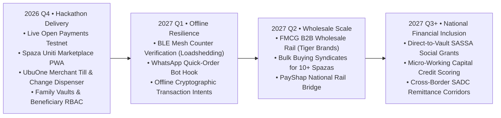

# Spaza Uniti & UbuOne

### Connected Township Commerce & Zero-Fee Micro-Payments via Open Payments
**Built by Team UX Giants for the Interledger & Open Payments Hackathon**

---

```
┌────────────────────────────────────────────────────────────────────────────────────────┐
│                                LIVE PRODUCTION DEPLOYMENTS                             │
├──────────────────────────────────┬─────────────────────────────────────────────────────┤
│ Spaza Uniti Marketplace PWA     │ https://spaza-uniti.vercel.app                     │
│ UbuOne Merchant & Family Portal  │ https://ubu-one-seven.vercel.app                   │
│ Interactive Presentation Deck    │ https://spaza-uniti.vercel.app/slides.html         │
│ Live Interledger Testnet Wallet  │ $ilp.interledger-test.dev/2f0b6b2c                  │
│ Verified Ed25519 Public Key ID   │ d644f013-289b-4c24-9cbe-c3e174cb5a0e (Active JWKS) │
└──────────────────────────────────┴─────────────────────────────────────────────────────┘
```

> *"Local township businesses deserve the financial infrastructure to compete. Local township customers deserve to benefit from that competition."*

---

## Table of Contents
1. [The Problem: The Township Cash Paradox](#the-problem-the-township-cash-paradox)
2. [The Solution: Dual-Rail Economic Engine](#the-solution-dual-rail-economic-engine)
3. [Core Systems & Platforms](#core-systems--platforms)
   - [Spaza Uniti (Consumer Marketplace PWA)](#1-spaza-uniti-consumer-marketplace-pwa)
   - [UbuOne (Merchant POS Till & Family Banking OS)](#2-ubuone-merchant-pos-till--family-banking-os)
4. [Key Architectural Innovations](#key-architectural-innovations)
   - [Human-Readable Usernames vs Cryptographic Addresses](#human-readable-usernames-vs-cryptographic-addresses)
   - [What Are UBUs? (Zero-Fee Liquidity Pool)](#what-are-ubus-zero-fee-liquidity-pool)
   - [Ubuntu Loyalty Tokens & The R20 Taxi Fare Cash-Out](#ubuntu-loyalty-tokens--the-r20-taxi-fare-cash-out)
   - [Role-Based Access Control (RBAC) & Family Vaults](#role-based-access-control-rbac--family-vaults)
   - [The "Change in UBU" Dispenser](#the-change-in-ubu-dispenser)
5. [System Architecture & Protocol Topology](#system-architecture--protocol-topology)
6. [Technology Stack](#technology-stack)
7. [Local Development & Quick Start](#local-development--quick-start)
8. [Demo Credentials & Personas](#demo-credentials--personas)
9. [Automated Verification & Testnet Walkthrough](#automated-verification--testnet-walkthrough)
10. [Roadmap & Future Horizon](#roadmap--future-horizon)

---

## The Problem: The Township Cash Paradox

South Africa's township economy represents over **R180 Billion ($10B+ USD)** in annual trade across **150,000+ informal spaza shops** and **10 Million+ daily shoppers**.

Despite widespread smartphone ownership and formal bank accounts (Capitec, TymeBank, SASSA grants), over **90% of township trade operates in physical cash**.

```
┌─────────────────────────┐  ┌─────────────────────────┐  ┌─────────────────────────┐
│     1. CASH FRICTION    │  │ 2. MICRO-PAYMENT WALL   │  │ 3. COIN & CREDIT TRAP   │
│                         │  │                         │  │                         │
│ • High armed robbery    │  │ • Minimum card swipe fee │  │ • Coin shortages force  │
│   risk for spaza owners │    of R1.50 - R2.50.        │    customers to accept    │
│   holding cash floats.  │  │ • A R5 bread slice or R10│    unwanted sweets/chews. │
│ • R15 - R35 ATM cash-out│    item loses 30% - 50%     │  │ • Informal notebook tab │
│   fees per withdrawal.  │    of gross sale to banks.  │    credit ('makhaya tabs')│
│ • Families lose 8% - 15%│  │ • Merchants refuse card  │    suffers 25%+ defaults  │
│   of income moving cash.│    swipes on small staples. │    and daily disputes.    │
└─────────────────────────┘  └─────────────────────────┘  └─────────────────────────┘
```

Township commerce is inherently **fractional** (R1 lollipop, R5 vetkoek, R16 bread, R18 lunch combo). Traditional card payment networks destroy merchant profit margins on small purchases through fixed minimum interchange fees.

---

## The Solution: Dual-Rail Economic Engine

Spaza Uniti and UbuOne bridge global **Interledger / Open Payments** rails with the day-to-day township micro-economy through a **Dual-Rail Architecture**:

```
┌────────────────────────────────────────────────────────────────────────────────────────┐
│                      RAIL 1: GLOBAL OPEN PAYMENTS (INTERLEDGER)                        │
│                Standardized, Interoperable, Cryptographically Signed                   │
│                                                                                        │
│   • On-Ramp: Salary / Grant / Bank Deposit -> UBU Pool (GNAP Interactive Grant)       │
│   • Off-Ramp: Merchant End-of-Day Settlement -> Commercial Bank Account (Capitec/FNB)  │
│   • Transit Off-Ramp: R20 Taxi Fare Cash-Out -> Live ILP Testnet Wallet                │
│   • Verified Payment Pointer: $ilp.interledger-test.dev/2f0b6b2c                       │
└──────────────────────────────────────────┬─────────────────────────────────────────────┘
                                           │ 1 Periodic Inflow On-Ramp (High Trust)
                                           ▼
┌────────────────────────────────────────────────────────────────────────────────────────┐
│                      RAIL 2: SPENDABLE UBU MICRO-PAYMENT ENGINE                        │
│                 Uniti-Wide • 1 UBU = R1.00 ZAR • R0.00 Transaction Fee                 │
│                                                                                        │
│   • Micro-transactions: R1 lollipop, R5 vetkoek, R16 bread slice, R18 Magwinya combo   │
│   • Multi-Tenant Family Vaults with automated daily/weekly allowance caps              │
│   • Adult Beneficiary Networks: Peer-to-peer sponsorship with category guardrails      │
│   • Instant Merchant POS Counter-Sale Settlement & Unified ACID Transactional Ledger   │
└────────────────────────────────────────────────────────────────────────────────────────┘
```

**The Breakthrough:** By isolating external network interchange costs to a **single periodic Open Payments on-ramp**, the community unlocks **hundreds of internal micro-transactions with zero fees (R0.00)**, backed 1:1 by real currency.

---

## Core Systems & Platforms

### 1. Spaza Uniti (Consumer Marketplace PWA)
*Live Deployment: [https://spaza-uniti.vercel.app](https://spaza-uniti.vercel.app)*

A mobile-first Progressive Web App designed for township shoppers:
- **Geo-Proximity Store Discovery:** GPS-based discovery of registered community Spaza Units (Unit 104, Unit 102, Unit 105, Unit 108 in Soweto, Khayelitsha, and Tembisa) with distance metrics, operating hours, and live till status.
- **Real-Time Storefront Broadcasting:** Shopkeepers broadcast time-sensitive daily lunch specials directly to neighbor feeds (e.g., *Magwinya Combo + Stoney for R18.00*).
- **Dual-Action Checkout:** Instant toggle between zero-fee **Spendable UBU** (pegged 1:1 with ZAR) and the Open Payments fiat reserve.
- **10% Loyalty Rewards & Taxi Fare Goal:** Automatically accumulates 10% cashback in Ubuntu Tokens toward a free **R20 Taxi Fare cash-out**.
- **Customer Modal:** Profile management, 1-click pool top-ups, adult beneficiary sponsorships, pending invitation approvals, and new handle registration.
- **Live Interledger Testnet Console:** Real-time visibility into `$ilp.testnet` connection status, Ed25519 signature verification, and live ILP stream packets.

### 2. UbuOne (Merchant POS Till & Family Banking OS)
*Live Deployment: [https://ubu-one-seven.vercel.app](https://ubu-one-seven.vercel.app)*

A multi-tenant fintech operating system running on affordable smartphones, tablets, or laptops:
- **Sub-Second POS Counter Till:** Ring up custom charges or quick-tap staples (R1 Lollipop, R5 Vetkoek, R16 Bread) against customer handles (`@mannini`, `@katlego`) with 4-digit PIN verification in <200ms at **zero transaction fee**.
- **"Change in UBU" Dispenser:** Permanently eliminates the coin shortage crisis. Cashiers dispense exact digital change (e.g. R1.50) directly to customer handles instead of unwanted sweets or bubblegum.
- **Multi-Tenant Family Vaults:** Household heads (`FAMILY_ADMIN`) pool grocery budgets, assign child handles (`@katlego`), and set automated **Daily Allowance Caps** (e.g. R50/day) with instant freeze/unfreeze controls.
- **Adult Beneficiaries Hub:** Autonomous adults search registered users, send sponsorship invitations with weekly draw limits (e.g. R80/week), and transfer instant UBU gifts.
- **Storefront Pacts & Promos:** Unit owners publish daily specials and configure automated loyalty stamp cards (*Staple Accumulator*).
- **1-Click End-of-Day Bank Settlement:** Sweeps accumulated till balances into commercial bank accounts (Capitec, FNB) via Open Payments, eliminating cash robbery risks.

---

## Key Architectural Innovations

### Human-Readable Usernames vs Cryptographic Addresses
In a busy spaza shop with queues outside, customers and cashiers cannot read, type, or verify 60-character cryptographic hashes, raw hex strings, or 16-digit card/IBAN numbers.
- **Our Solution:** Every participant registers a clean, memorable handle: e.g. `@mannini`, `@katlego`, `@sipho`.
- **Under the Hood:** Our resolver automatically maps that handle to a fully compliant Open Payments Wallet Address:
  $$\text{@mannini} \longrightarrow \text{\$spazauniti.org/mannini} \quad (\text{or } \text{http://localhost:8001/mannini})$$
- Cashiers simply enter the handle and prompt for a 4-digit PIN. The system resolves the payment pointer, verifies identity, and records the ACID ledger transaction seamlessly.

### What Are UBUs? (Zero-Fee Liquidity Pool)
- **Spendable UBU** is our Uniti-wide internal digital currency, strictly pegged **1:1 to the South African Rand (1 UBU = R1.00 ZAR)**.
- **UBU is NOT a cryptocurrency.** It is NOT a volatile or speculative asset. It is a deterministic, closed-loop community liquidity pool backed 1:1 by fiat currency in an Open Payments reserve.
- Money enters the pool through a single Open Payments deposit. Once inside, money circulates among shoppers, students, and merchants at **zero network fee (R0.00)**. When a merchant or consumer cashes out, UBU converts back 1:1 into real fiat.

### Ubuntu Loyalty Tokens & The R20 Taxi Fare Cash-Out
- Every purchase made at a registered Spaza Unit automatically earns **10% cashback in Ubuntu Tokens** (e.g., spending R18 earns +1.80 UBU).
- Tokens are tracked per participating unit (e.g., Unit 104, Unit 102).
- When a customer accumulates **20.0 UBU** in loyalty rewards, the system unlocks **Taxi Fare Cash-Out Eligibility**. With one click, the customer can off-ramp those 20 tokens via the Open Payments testnet into a real transit allowance, effectively making their daily commute to work or school free.

### Role-Based Access Control (RBAC) & Family Vaults
Township household finances are communal. Our multi-tenant RBAC architecture reflects this social reality:
1. **Family Admin (`FAMILY_ADMIN`, e.g. `@mannini`):** Provisions child accounts, funds the vault, sets daily allowance caps, and monitors family spending.
2. **Family Member / Child (`FAMILY_MEMBER`, e.g. `@katlego`):** Draws from the family vault up to their daily allowance cap (R50/day) at the till with their 4-digit PIN. Cannot overspend.
3. **Adult Individual (`ADULT_INDIVIDUAL`):** Autonomous adults who top up their own personal UBU balances, search consumers, and send **Beneficiary Invitations** with weekly allowance caps and category guardrails (*'Groceries & Essentials'*).
4. **Unit Cashier (`UNIT_CASHIER`, passcode `1111`):** Till operator charging customer handles and dispensing "Change in UBU".
5. **Unit Owner (`UNIT_OWNER`, passcode `1040`):** Manages specials, loyalty pacts, and 1-click bank settlement.

### The "Change in UBU" Dispenser
When a customer pays with a R20 banknote for a R18.50 item and the cashier has no coins:
1. Cashier taps **Change in UBU** on the till.
2. Enters customer handle `@katlego` and amounts.
3. The system dispatches **+1.50 UBU** directly to the customer's mobile wallet.
4. The customer leaves with their real money intact; the spaza avoids coin shortage disputes.

---

## System Architecture & Protocol Topology

```
┌────────────────────────────────────────────────────────────────────────────────────────┐
│                        GLOBAL INTERLEDGER / OPEN PAYMENTS NETWORK                      │
│                                                                                        │
│     Live Testnet Wallet: $ilp.interledger-test.dev/2f0b6b2c                            │
│     Auth Server (GNAP):  https://auth.interledger-test.dev                             │
│     Resource Server:     https://ilp.interledger-test.dev (Rafiki v1.0)                │
└──────────────────────────────────────────┬─────────────────────────────────────────────┘
                                           │ RFC 9421 Ed25519 HTTP Signatures
                                           │ SHA-512 Content-Digest & GNAP Grants
                                           ▼
┌────────────────────────────────────────────────────────────────────────────────────────┐
│                       SPAZA UNITI CORE GATEWAY (FastAPI :8001)                         │
│                                                                                        │
│   • Open Payments Signing Engine (Ed25519 hazmat, RFC 9421)                            │
│   • Payment Pointer & Handle Resolver ($spazauniti.org/{username})                     │
│   • Multi-Tenant Consumer & Merchant RBAC Engine                                       │
│   • Deterministic ACID Transactional Ledger (ubuone_ledger, transactions)              │
│   • Geo-Proximity & Broadcast Engine                                                   │
└───────────────────────┬────────────────────────────────────────┬───────────────────────┘
                        │ REST & Open Payments APIs              │ RBAC & Ledger APIs
                        ▼                                        ▼
┌──────────────────────────────────────────┐  ┌──────────────────────────────────────────┐
│        SPAZA UNITI MARKETPLACE PWA       │  │        UBUONE FINTECH WORKSPACE          │
│         https://spaza-uniti.vercel.app   │  │         https://ubu-one-seven.vercel.app │
│                                          │  │                                          │
│ • Geo-Proximity Store Discovery          │  │ • Rapid Counter POS Till (<200ms)        │
│ • Real-Time Daily Specials Broadcast     │  │ • Change-in-UBU Coin Dispenser           │
│ • Dual-Action Cart (UBU 0% vs Reserve)   │  │ • Family Vaults & Child Allowance Caps   │
│ • 10% Loyalty & R20 Taxi Fare Tracker    │  │ • Adult Beneficiaries Sponsorship Hub    │
│ • Customer Wallet & Network Hub          │  │ • 1-Click End-of-Day Bank Settlement     │
└──────────────────────────────────────────┘  └──────────────────────────────────────────┘
```

---

## Technology Stack

| Layer | Technologies |
| :--- | :--- |
| **Open Payments Protocol** | Interledger Protocol (ILP), Rafiki v1.0, GNAP (Grant Negotiation and Authorization Protocol), RFC 9421 HTTP Message Signatures, Ed25519 Asymmetric Cryptography, SHA-512 Digests |
| **Backend Core** | Python 3.10+, FastAPI, Uvicorn, SQLite3 with ACID Locking, Pydantic v2, `cryptography.hazmat` (zero Node runtime dependencies for crypto signing) |
| **Consumer Frontend** | React 19, Vite, Tailwind CSS, Lucide React, Progressive Web App (PWA) Manifest & Service Workers |
| **Merchant Frontend** | React 19, Vite, Tailwind CSS, Radix UI Primitives, Lucide Icons, Mobile-Optimized Touch UI |
| **Deployments** | Vercel Serverless Hosting, GitHub Actions CI/CD |

---

## Local Development & Quick Start

### Prerequisites
- Node.js (v18+) and npm
- Python (v3.10+) and `venv`
- OpenSSL / libsodium

### 1. Clone the Repository
```bash
git clone https://github.com/azaria-ux/spazakhokha.git
cd spazakhokha
```

### 2. Start the Spaza Uniti Core Backend (:8001)
```bash
cd services/uniti-backend/SpazaUniti-Backend
./run.sh
```
*Backend runs on `http://localhost:8001`. Interactive API docs: `http://localhost:8001/docs`.*

### 3. Start the UbuOne Merchant & Family Portal (:3000)
```bash
cd services/ubu-one/UbuOne-Frontend
./run.sh
```
*UbuOne runs on `http://localhost:3000`.*

### 4. Start the Spaza Uniti Consumer Marketplace (:3001)
```bash
cd SpazaUniti-Frontend
./run.sh
```
*Spaza Uniti runs on `http://localhost:3001`.*

---

## Demo Credentials & Personas

| Persona | Role | Access / Handle | Credentials | Key Action to Demonstrate |
| :--- | :--- | :--- | :--- | :--- |
| **Mama Khumalo** | Unit Owner (Unit 104) | `khumalo_owner` | Passcode: `1040` | Broadcast daily specials; 1-click end-of-day bank settlement via Open Payments. |
| **Thabo Maseko** | Cashier (Till 104) | `thabo_cashier` | Passcode: `1111` | Sub-200ms POS counter charges; dispense R1.50 "Change in UBU" to phone wallets. |
| **Mannini Morake** | Family Admin / Shopper | `@mannini` | PIN: `1234` | Dual-action checkout at R0.00 fee; manage Family Vault allowances for child Katlego. |
| **Katlego Morake** | Child / Dependent | `@katlego` | PIN: `1234` | Pay for lunch with 4-digit PIN at counter till within R50 daily allowance cap. |
| **Sipho Ndlovu** | Adult Individual | `@sipho` | PIN: `1234` | Send Adult Beneficiary Invitations; stream weekly grocery allowances to family. |

---

## Automated Verification & Testnet Walkthrough

A comprehensive end-to-end Python test script is included to programmatically verify all 8 core stages against the live Rafiki testnet:

```bash
# Run end-to-end automated walkthrough
./Backend/venv/bin/python walkthrough_automated.py
```

### Verification Pipeline:
- **Step 1:** Live Open Payments Testnet status & Ed25519 JWKS verification.
- **Step 2:** Creation of genuine RFC 9421 HTTP-signed incoming payment (HTTP 201 with live ILP stream packet).
- **Step 3:** Interactive GNAP top-up grant and 1:1 UBU pool funding.
- **Step 4:** Geo-proximity discovery query (Soweto units verified).
- **Step 5:** Zero-fee consumer purchase of Magwinya Combo (18.00 UBU debited, 10% loyalty tokens awarded).
- **Step 6:** Cashier login (`thabo_cashier` / `1111`) and POS till charge verification with customer PIN (`1234`).
- **Step 7:** Dispensing "Change in UBU" (R1.50 change credited to phone).
- **Step 8:** Off-ramp R20 Taxi Fare cash-out to the Interledger testnet wallet (`$ilp.interledger-test.dev/2f0b6b2c`).

---

## Roadmap & Future Horizon



---

## Credits & License

- **Team:** UX Giants (Azaria Morake & Team)
- **Competition:** Interledger & Open Payments Hackathon 2026
- **License:** Apache 2.0 / MIT Open Source
