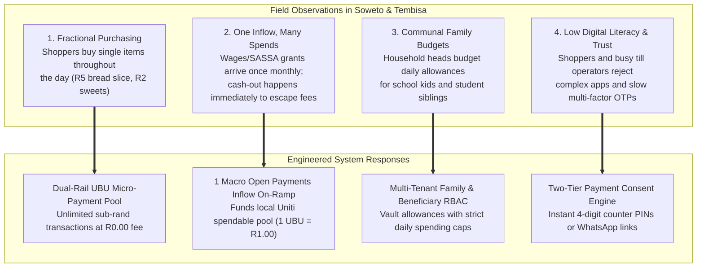
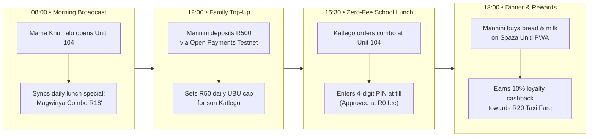
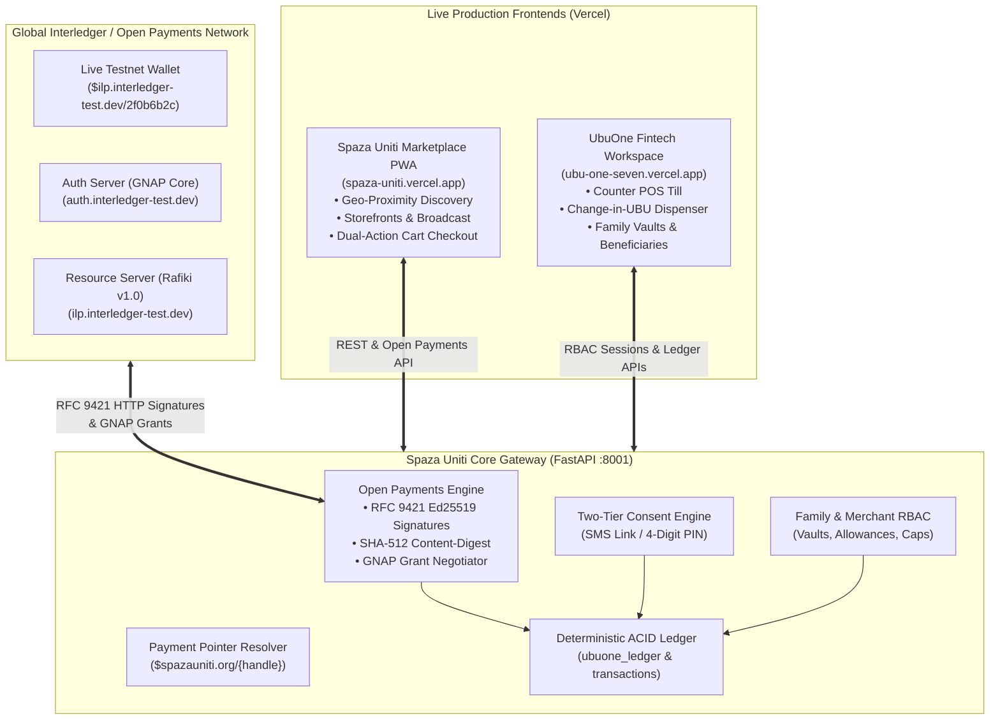
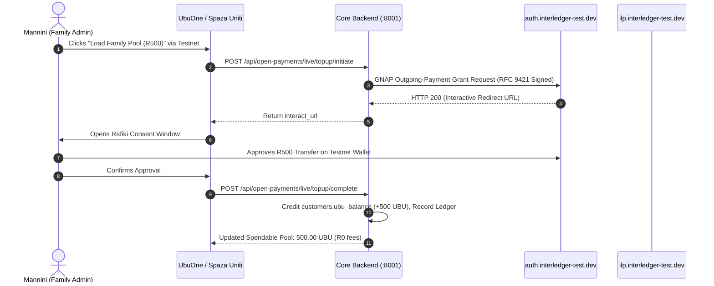
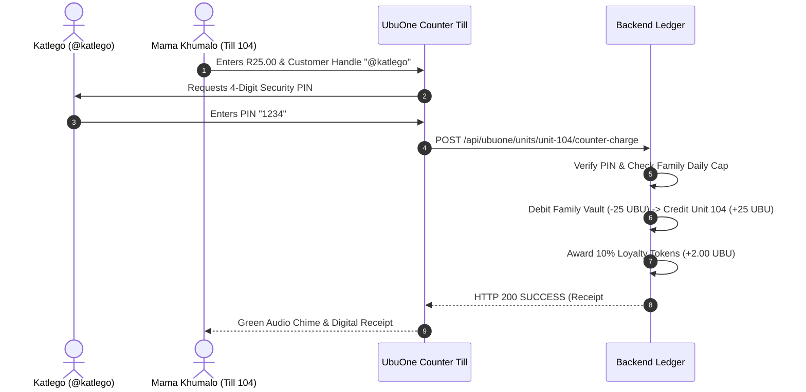
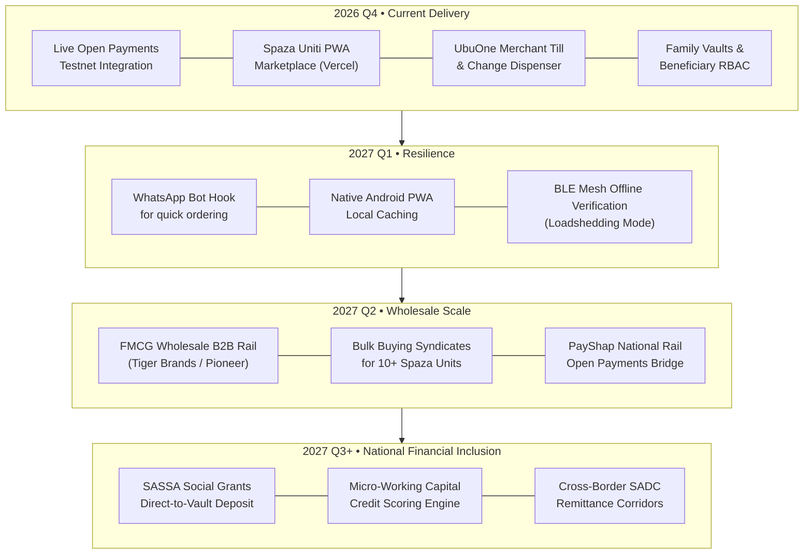

# Spaza Uniti & UbuOne
## Connected Township Commerce & Zero-Fee Micro-Payments via Open Payments
### Hackathon Presentation & Technical Slide Deck (v2)

---

## Slide 1: Title & Executive Summary


# Spaza Uniti & UbuOne
### *A Connected Township Commerce & Zero-Fee Micro-Payment Ecosystem Powered by Interledger*

**Category:** Financial Inclusion • Open Payments • Interledger Protocol (ILP) • Consumer & Merchant Fintech  
**Team:** UX Giants (Azaria Morake & Team)  

```
┌────────────────────────────────────────────────────────────────────────────────────────┐
│                                  PRODUCTION DEPLOYMENTS                                │
├──────────────────────────────────┬─────────────────────────────────────────────────────┤
│ Spaza Uniti Marketplace PWA     │ https://spaza-uniti.vercel.app                     │
│ UbuOne Merchant & Family Portal  │ https://ubu-one-seven.vercel.app                   │
│ Interactive Web Slide Deck       │ https://spaza-uniti.vercel.app/slides.html         │
│ Live Interledger Testnet Wallet  │ $ilp.interledger-test.dev/2f0b6b2c                  │
│ Ed25519 Public Key ID            │ d644f013-289b-4c24-9cbe-c3e174cb5a0e (Active JWKS) │
└──────────────────────────────────┴─────────────────────────────────────────────────────┘
```

> *"Local township businesses deserve the financial infrastructure to compete. Local township customers deserve to benefit from that competition."*

<br>

> **Pitch Delivery Guidance:**  
> Welcome judges and fellow builders. Today, we present Spaza Uniti and UbuOne. We have engineered an end-to-end, dual-rail financial and commerce ecosystem designed specifically for the South African township economy. By combining the global standard of Interledger and Open Payments with our localized zero-fee micro-payment pool called Ubu, we eliminate predatory swipe fees, eradicate cash robbery risks, and connect township merchants into a federated digital marketplace.

---

## Slide 2: The Township Paradox & Market Opportunity

### R180 Billion in Annual Cash Trade, Yet Trapped by Friction
South Africa's township economy represents over **R180 Billion ($10B+ USD)** in annual trade across **150,000+ informal spaza shops** and **10 Million+ daily shoppers**. Despite widespread smartphone ownership, it operates almost entirely on physical cash.

```
┌─────────────────────────┐  ┌─────────────────────────┐  ┌─────────────────────────┐
│     1. CASH FRICTION    │  │ 2. MICRO-PAYMENT WALL   │  │ 3. PAPER CREDIT TABS    │
│                         │  │                         │  │                         │
│ • High armed robbery    │  │ • Card interchange has a│  │ • Neighborhood credit   │
│   risk for spaza owners │    minimum swipe fee of    │    ('makhaya tabs') tracked│
│   holding cash floats.  │    R1.50 - R2.50.          │    in paper notebooks.     │
│ • R15 - R35 ATM cash-out│  │ • A R5.00 bread slice,  │  │ • Zero audit trail,     │
│   fees per withdrawal.  │    R3 snack, or R10 soup   │    frequent disputes, and  │
│ • Families lose 8% - 15%│    loses 30% to 50% in fees│    25%+ default rate.      │
│   of income moving cash.│  │ • Merchants reject card │  │ • Bad debts threaten    │
│ • Coin shortages cause  │    terminals for essential │    shop solvency and       │
│   'sweet change' fights.│    sub-rand staples.       │    community trust.        │
└─────────────────────────┘  └─────────────────────────┘  └─────────────────────────┘
```

### The Market Opportunity
Township shoppers already hold digital bank accounts (Capitec, TymeBank, SASSA social grants). What has been missing is **an open, interoperable payment infrastructure that can economically process a R2.00 or R5.00 purchase without destroying merchant margins in card interchange fees.**

<br>

> **Pitch Delivery Guidance:**  
> To understand why digital payments have historically failed South African townships, look at unit economics. When a customer buys a loose cigarette for R3.00 or half a loaf of bread for R8.00, traditional card networks charge a minimum swipe fee of R1.50 or more. That wipes out the shopkeeper's entire profit margin. Meanwhile, consumers pay exorbitant ATM fees just to withdraw their salaries in cash, only to walk into the township and risk being robbed. Spaza Uniti and UbuOne resolve this economic paradox.

---

## Slide 3: Field Research — 4 Truths of Township Commerce

Our field research across **Soweto, Tembisa, Alexandra, and Khayelitsha** revealed four behavioral truths that dictated our technical architecture:



| Field Insight | Observed Reality | Engineered Architecture |
| :--- | :--- | :--- |
| **1. Fractional Purchasing** | Customers purchase in tiny increments throughout the day rather than one large supermarket trip. | **Dual-Rail UBU Engine:** Unlimited sub-rand micro-transactions with zero per-transaction network fees. |
| **2. One Inflow, Many Spends** | Wages or social grants arrive once monthly; cash-out happens immediately to avoid bank fees. | **Open Payments On-Ramp:** 1 periodic external inflow on-ramp funds a spendable UBU pool (1 UBU = R1.00 ZAR). |
| **3. Communal Family Budgets** | Household heads budget for children, grandparents, and student relatives who buy daily groceries. | **Family & Beneficiary RBAC:** Shared family vaults with daily caps and 4-digit PIN authorizations for dependents. |
| **4. Low Digital Literacy / Trust** | Shopkeepers do not want complex accounting software; shoppers do not want complex apps for small purchases. | **Frictionless Consent:** Rapid 4-digit counter PINs at the merchant till or interactive WhatsApp/SMS push links. |

<br>

> **Pitch Delivery Guidance:**  
> Our field research uncovered that township finances are communal and fractional. A mother receives her salary or child grant once a month, but her household makes ten small purchases a day. If every purchase carried a network fee, the household would starve. Furthermore, mothers need to allocate money to their children at school without handing over cash that could be lost or stolen. These four insights directly inspired our architecture.

---

## Slide 4: User Stories & Persona Journeys



### The Three Personas
1. **Mama Khumalo (Shopkeeper, "Unit 104"):**
   - *Goal:* Accept digital payments without card fees, eliminate coin shortage disputes, and broadcast daily specials to neighbors.
   - *Experience:* Opens counter till on UbuOne &rarr; Enters amount and customer handle (`@katlego`) &rarr; Customer enters 4-digit PIN &rarr; Till chimes success in 200ms with zero network fee &rarr; 1-click end-of-day bank cash-out via Open Payments.
2. **Mannini (Household Head & Family Admin):**
   - *Goal:* Budget family grocery money safely and earn cashback that covers daily transport costs.
   - *Experience:* Loads R500 once from Capitec via Open Payments testnet &rarr; Allocates R50 daily allowance to son Katlego &rarr; Shops nearby units on Spaza Uniti marketplace &rarr; Earns 10% loyalty cashback toward a R20 taxi fare.
3. **Katlego (High School Student & Dependent):**
   - *Goal:* Buy after-school lunch and bread for home without carrying cash that could get stolen.
   - *Experience:* Walks to Unit 104 &rarr; Orders Magwinya combo &rarr; Taps 4-digit PIN at counter till &rarr; Till debits mother's family vault within his daily limit &rarr; Zero physical cash touched.

<br>

> **Pitch Delivery Guidance:**  
> Here are our three core users. Mama Khumalo runs Unit 104 in Soweto. She uses our UbuOne till to eliminate coin shortages and accept zero-fee payments. Mannini is a working mother who tops up her family pool once using Open Payments, sets a R50 daily allowance for her son Katlego, and monitors spending. Katlego goes to Unit 104, provides his handle and 4-digit PIN, and walks away with his food in seconds—with zero fees deducted from either party.

---

## Slide 5: The Dual-Rail Economic Engine

Spaza Uniti and UbuOne bridge global Interledger payment rails and township micro-commerce through a **Dual-Rail Architecture**:

```
┌────────────────────────────────────────────────────────────────────────────────────────┐
│                      RAIL 1: GLOBAL OPEN PAYMENTS (INTERLEDGER)                        │
│                Standardized, Interoperable, Cryptographically Signed                   │
│                                                                                        │
│   • On-Ramp: Salary / Grant / Bank Deposit -> UBU Pool (GNAP Interactive Grant)       │
│   • Off-Ramp: Merchant End-of-Day Settlement -> Commercial Bank Account (Capitec/FNB)  │
│   • Transit Off-Ramp: R20 Taxi Fare Cash-Out -> Live ILP Testnet Wallet                │
│   • Payment Pointer: $ilp.interledger-test.dev/2f0b6b2c                                │
└──────────────────────────────────────────┬─────────────────────────────────────────────┘
                                           │ 1 Periodic Inflow On-Ramp (High Trust)
                                           ▼
┌────────────────────────────────────────────────────────────────────────────────────────┐
│                      RAIL 2: SPENDABLE UBU MICRO-PAYMENT ENGINE                        │
│                 Uniti-Wide • 1 UBU = R1.00 ZAR • R0.00 Transaction Fee                 │
│                                                                                        │
│   • Micro-transactions: R1.50 sweets, R5.00 bread slices, R18.00 Magwinya Special      │
│   • Family Vaults & Child Allowances with Automated Daily/Weekly Spending Limits       │
│   • Adult Beneficiary Networks: Sponsor elderly relatives or student siblings          │
│   • Instant Merchant POS Counter-Sale Settlement & Unified ACID Transactional Ledger   │
└────────────────────────────────────────────────────────────────────────────────────────┘
```

> [!TIP]
> **The Economic Innovation:** By isolating high-friction external network costs to a single periodic Open Payments on-ramp, the community unlocks **hundreds of internal micro-transactions with zero fees**, backed 1:1 by real currency.

<br>

> **Pitch Delivery Guidance:**  
> Our key breakthrough is the Dual-Rail Architecture. Rail 1 is the global Interledger standard for macro-events: depositing salaries, cashing out merchant revenue, or streaming transit allowances. Rail 2 is our Spendable UBU engine. One UBU is strictly pegged 1:1 to one South African Rand. Once liquidity enters the township pool, money circulates between shoppers, school kids, and spaza shops with zero per-transaction fees. This makes buying a R2 sweet economically viable for the first time.

---

## Slide 6: Full-Stack System Architecture & Protocol Topology



<br>

> **Pitch Delivery Guidance:**  
> Here is our technical topology. On the left is the live Interledger testnet, running Rafiki with GNAP authentication and RFC 9421 HTTP message signatures. In the center is our FastAPI core service orchestrating the deterministic ACID financial ledger, the Open Payments cryptographic signer, and our RBAC engine. On the right are our two live frontends on Vercel: Spaza Uniti for consumers and UbuOne for merchant point-of-sale and family budgeting.

---

## Slide 7: Information Architecture & Core User Flows

### Flow A: Interactive Open Payments On-Ramp (Salary &rarr; UBU Pool)


### Flow B: Zero-Fee In-Store Till Payment with 4-Digit PIN


<br>

> **Pitch Delivery Guidance:**  
> These sequence diagrams demonstrate our two primary transactional flows. In Flow A, Mannini initiates a top-up. Our backend cryptographically signs an RFC 9421 request to the Interledger Auth Server, opens a genuine Rafiki consent prompt, and upon approval credits 500 UBU to her spendable balance. In Flow B, her son Katlego purchases food at Unit 104. The cashier types R25 and @katlego. Katlego taps in his 4-digit security PIN. The backend verifies the PIN against his parent's daily limit, debits the vault, credits the spaza till, and awards 10% loyalty cashback—all within 200 milliseconds and at zero network cost.

---

## Slide 8: Platform Showcase — Spaza Uniti Marketplace


### Live Customer Experience • [https://spaza-uniti.vercel.app](https://spaza-uniti.vercel.app)

```
┌────────────────────────────────────────────────────────────────────────────────────────┐
│                              CORE MARKETPLACE CAPABILITIES                             │
├──────────────────────────┬─────────────────────────────────────────────────────────────┤
│ Geo-Proximity Engine     │ Locates registered Spaza Units across Soweto, Khayelitsha, │
│                          │ and Tembisa with real-time operational status.             │
├──────────────────────────┼─────────────────────────────────────────────────────────────┤
│ Storefront Broadcasting  │ Displays live daily lunch specials, discounts, and combos   │
│                          │ directly from shopkeepers (e.g. Magwinya Combo R18).        │
├──────────────────────────┼─────────────────────────────────────────────────────────────┤
│ Dual-Action Checkout     │ Instant 1-click toggle between Spendable UBU (zero fee) and │
│                          │ Bank / Open Payments Reserve.                               │
├──────────────────────────┼─────────────────────────────────────────────────────────────┤
│ Live Testnet Console     │ Header pill links to $ilp.testnet console showing live ILP  │
│                          │ stream packets and Ed25519 JWKS verification.               │
├──────────────────────────┼─────────────────────────────────────────────────────────────┤
│ 10% Loyalty Cashback     │ Automatically accumulates 1 UBU per R10 spent toward a      │
│                          │ free R20 taxi fare cash-out.                                │
└──────────────────────────┴─────────────────────────────────────────────────────────────┘
```

<br>

> **Pitch Delivery Guidance:**  
> Spaza Uniti gives township consumers a sleek, modern shopping experience with real-time merchant broadcasts. Customers can discover nearby stores, view real-time lunch specials, pay with spendable UBU at zero fee, and track their loyalty cashback toward free taxi rides.

---

## Slide 9: Platform Showcase — UbuOne Merchant Till & Family Portal


### Merchant POS & Family Banking • [https://ubu-one-seven.vercel.app](https://ubu-one-seven.vercel.app)

```
┌────────────────────────────────────────────────────────────────────────────────────────┐
│                               UBUONE WORKSPACE CAPABILITIES                            │
├──────────────────────────┬─────────────────────────────────────────────────────────────┤
│ Rapid Counter POS Till   │ Cashiers enter custom amounts, target customer handles      │
│                          │ (@katlego), and verify instantly via 4-digit PIN.           │
├──────────────────────────┼─────────────────────────────────────────────────────────────┤
│ Change-in-UBU Dispenser  │ Solves coin shortages: issues exact digital change          │
│                          │ (e.g. R1.50) directly to customer phones instead of sweets. │
├──────────────────────────┼─────────────────────────────────────────────────────────────┤
│ Family Admin Vaults      │ Pooled UBU budgeting where parents set automated daily      │
│                          │ allowance caps and spend categories for children.           │
├──────────────────────────┼─────────────────────────────────────────────────────────────┤
│ Adult Beneficiaries      │ Direct peer-to-peer allowance streaming to sponsor elderly  │
│                          │ relatives and student siblings.                             │
├──────────────────────────┼─────────────────────────────────────────────────────────────┤
│ End-of-Day Settlement    │ 1-click batch payout from spaza till balance to commercial   │
│                          │ bank accounts via Open Payments.                            │
└──────────────────────────┴─────────────────────────────────────────────────────────────┘
```

<br>

> **Pitch Delivery Guidance:**  
> UbuOne transforms any tablet or smartphone into an intelligent POS till. It solves the famous township coin shortage: instead of handing a customer an unwanted sweet as change, the cashier taps 'Issue Change in UBU', and R1.50 is instantly credited to their phone. On the consumer side, Family Vaults allow parents to budget allowances with strict daily caps.

---

## Slide 10: Cryptography & Open Payments Standards

```
┌────────────────────────────────────────────────────────────────────────────────────────┐
│                              CRYPTOGRAPHIC SPECIFICATIONS                              │
├──────────────────────────┬─────────────────────────────────────────────────────────────┤
│ Standard / Component     │ Implementation Detail                                       │
├──────────────────────────┼─────────────────────────────────────────────────────────────┤
│ Algorithm                │ Ed25519 asymmetric signature scheme                         │
├──────────────────────────┼─────────────────────────────────────────────────────────────┤
│ RFC 9421 Coverage        │ "@method", "@target-uri", "content-digest", "authorization" │
├──────────────────────────┼─────────────────────────────────────────────────────────────┤
│ Digest Format            │ SHA-512 base64 digest formatted as sha-512=:<hash>:         │
├──────────────────────────┼─────────────────────────────────────────────────────────────┤
│ Authorization Standard   │ GNAP (Grant Negotiation and Authorization Protocol)         │
├──────────────────────────┼─────────────────────────────────────────────────────────────┤
│ Runtime Architecture     │ Pure Python (cryptography.hazmat) with zero Node deps       │
├──────────────────────────┼─────────────────────────────────────────────────────────────┤
│ Verified Key ID          │ d644f013-289b-4c24-9cbe-c3e174cb5a0e (Verified on JWKS)     │
└──────────────────────────┴─────────────────────────────────────────────────────────────┘
```

### Live Testnet Verification Output
```json
{
  "connected": true,
  "network": "Interledger Testnet (Rafiki v1.0)",
  "payment_pointer": "$ilp.interledger-test.dev/2f0b6b2c",
  "key_id": "d644f013-289b-4c24-9cbe-c3e174cb5a0e",
  "auth_server": "https://auth.interledger-test.dev/f537937b-7016-481b-b655-9f0d1014822c",
  "resource_server": "https://ilp.interledger-test.dev/f537937b-7016-481b-b655-9f0d1014822c",
  "ilp_address": "local.test.net.4iA693dIkmutAAcw2x209rHO2ss-G1LoJl8YNwjpJs7XzgF9USEHK30Ol7yehjYe-IL23VD1BZhQ1gd2xiz48IGyhZLO2bw",
  "shared_secret": "nTqXwkbmIYLqSG5OhoIQnFUrpam4Gt2m7p4V-EOBK6o"
}
```

<br>

> **Pitch Delivery Guidance:**  
> We implemented full cryptographic compliance with Open Payments standards. Our backend generates genuine RFC 9421 HTTP message signatures in pure Python using Ed25519 keys, matching the exact format required by Rafiki. We support GNAP for both interactive user consent and non-interactive server grants.

---

## Slide 11: Technical Challenges & Engineering Breakthroughs

```
┌────────────────────────────────────────────────────────────────────────────────────────┐
│                              HOW WE SOLVED HARD PROBLEMS                               │
├──────────────────────────┬─────────────────────────────────────────────────────────────┤
│ Challenge Encountered    │ Technical Breakthrough & Resolution                         │
├──────────────────────────┼─────────────────────────────────────────────────────────────┤
│ 1. Interledger Testnet   │ Cloudflare blocks Python's default User-Agent with HTTP 403.│
│    WAF / Cloudflare 403  │ Resolved by implementing RFC-compliant custom client headers│
│                          │ (SpazaUniti-OpenPayments/1.0) across all outgoing requests. │
├──────────────────────────┼─────────────────────────────────────────────────────────────┤
│ 2. RFC 9421 HTTP Message │ Rafiki requires strict signature coverage: @method,         │
│    Signatures in Python  │ @target-uri, content-digest (SHA-512), and GNAP auth token. │
│                          │ Built pure Python signing engine using Ed25519 private keys │
│                          │ with zero external Node runtime dependencies.               │
├──────────────────────────┼─────────────────────────────────────────────────────────────┤
│ 3. Micro-Payment Fee     │ Traditional card networks destroy sub-R10 transactions.     │
│    Destruction           │ Engineered 1 UBU = R1.00 local liquidity buffer. A single   │
│                          │ Open Payments inflow unlocks infinite zero-fee transactions.│
├──────────────────────────┼─────────────────────────────────────────────────────────────┤
│ 4. Real-Time Cross-App   │ Spaza Uniti purchases must reflect immediately on UbuOne    │
│    Ledger Sync           │ merchant cashiers. Created a unified SQLite transactional   │
│                          │ schema with ACID locking and synchronized ledger events.    │
└──────────────────────────┴─────────────────────────────────────────────────────────────┘
```

<br>

> **Pitch Delivery Guidance:**  
> Building on bleeding-edge payment protocols always brings challenges. We overcame Cloudflare WAF blocks on the testnet, solved exact RFC 9421 signature coverage requirements for Rafiki, engineered the 1:1 UBU buffer to defeat interchange fees, and unified the transactional ledger so purchases instantly reflect across all cashiers.

---

## Slide 12: Expected Impact & Economic Scalability

### Quantifiable Socio-Economic Impact

```
┌─────────────────────────────────┐   ┌─────────────────────────────────┐
│     TOWNSHIP HOUSEHOLD GAIN     │   │      SPAZA MERCHANT GAIN        │
│                                 │   │                                 │
│  • Saves R180 - R320 / month    │   │  • Eliminates cash robbery risk │
│    in predatory ATM cashout fees│   │  • Reduces tab defaults by 80%  │
│  • Eliminates lost/stolen cash  │   │  • Saves 2.5% to 4% card fees   │
│  • Earns 1 free taxi trip every │   │  • Instant cross-unit federation│
│    R200 in neighborhood spend   │   │    attracts 25%+ more shoppers  │
└─────────────────────────────────┘   └─────────────────────────────────┘
```

### Macro Scalability
- **Horizontal Federation:** Any township spaza shop can download UbuOne, provision an Open Payments wallet address (`$spazauniti.org/{unit_id}`), and become a licensed node in 2 minutes.
- **National Reach:** Directly extensible across **150,000 South African spaza shops** and adaptable to informal trade across Sub-Saharan Africa (Kenya, Nigeria, Ghana, Tanzania).
- **Interoperability:** Because we strictly adhere to Open Payments standards, any commercial bank or mobile money operator (Vodacom M-Pesa, MTN MoMo, Capitec) can bridge directly into the Uniti network.

<br>

> **Pitch Delivery Guidance:**  
> The impact of this project is immediate and tangible. For a low-income household earning R4,000 a month, saving R250 in ATM fees and earning free taxi rides represents an effective 8% increase in disposable income. For Mama Khumalo, eliminating cash means she is no longer a target for armed robberies, and her credit tabs are auditable and automatically settled. Because our architecture is federated and built on open standards, any spaza shop in South Africa or across Africa can join without proprietary hardware.

---

## Slide 13: Strategic Horizon & Conclusion




### Live Production Deployments & Links
- **Spaza Uniti Marketplace PWA:** [https://spaza-uniti.vercel.app](https://spaza-uniti.vercel.app)
- **UbuOne Merchant Till & Family Portal:** [https://ubu-one-seven.vercel.app](https://ubu-one-seven.vercel.app)
- **Interactive Web Slide Deck:** [https://spaza-uniti.vercel.app/slides.html](https://spaza-uniti.vercel.app/slides.html)
- **Native PowerPoint Deck:** [presentation.pptx](file:///home/azaria/ux-giants/spazakhokha/presentation.pptx)
- **Interledger Testnet Payment Pointer:** `$ilp.interledger-test.dev/2f0b6b2c`
- **Ed25519 Public Key ID:** `d644f013-289b-4c24-9cbe-c3e174cb5a0e`

### **Thank You! We Welcome Your Questions.**

<br>

> **Pitch Delivery Guidance:**  
> To conclude: Spaza Uniti and UbuOne prove that the township economy does not need second-class solutions. By using open standards like Interledger and Open Payments, we give local merchants the power to compete and give township families the dignity of zero-fee digital commerce. All our services are running live, tested against the Interledger testnet, and ready for deployment. Thank you for your time, and we look forward to your questions.
